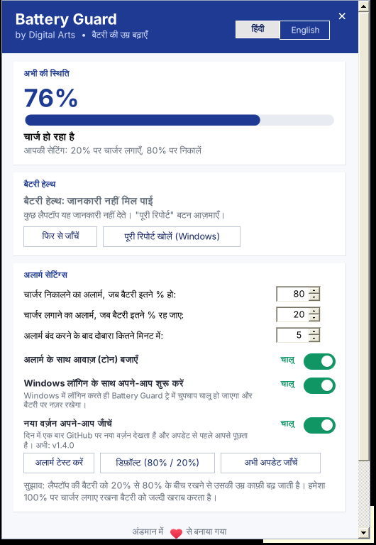
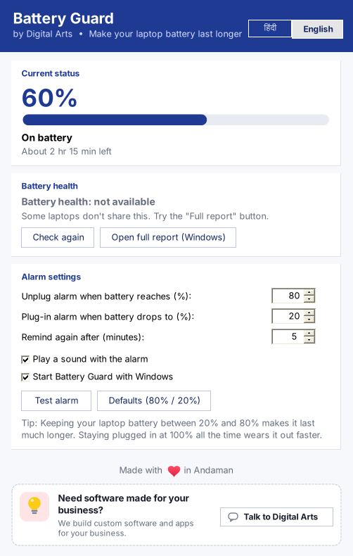

# Battery Guard v1.5 – by Digital Arts

लैपटॉप बैटरी की उम्र बढ़ाने वाला मुफ़्त Windows ऐप। *Made with ♥ in Andaman.*

A free Windows app that reminds you to unplug the charger at 80% and plug it in at 20%, so your laptop battery lasts longer.

## ⬇️ डाउनलोड / Download

**[BatteryGuard.exe डाउनलोड करें](https://github.com/datplindia/digital-toolbox-updates/raw/main/battery-guard/BatteryGuard.exe)**: Windows 10 / 11, लगभग 70 KB। कुछ भी इंस्टॉल नहीं करना पड़ता।

| हिंदी | English |
|---|---|
|  |  |

## फ़ीचर / Features

- बैटरी **80%** पर पहुँचते ही पॉपअप और आवाज़: "चार्जर निकाल दें"। **20%** पर: "चार्जर लगाएँ"।
- चार्जर निकालते या लगाते ही अलार्म अपने-आप बंद हो जाता है।
- **बैटरी हेल्थ:** नई बैटरी के मुकाबले अब कितनी क्षमता बची है, और Windows की पूरी बैटरी रिपोर्ट।
- दोनों % लेवल, आवाज़ और दोबारा याद दिलाने का समय अपनी पसंद से।
- **हिंदी / English** टॉगल।
- ट्रे (नीचे दाएँ कोने) में चुपचाप चलता है। ट्रे आइकन पर क्लिक करते ही पैनल स्क्रीन के दाईं तरफ़, टास्कबार के ठीक ऊपर खुलता है।
- **Windows लॉगिन के साथ शुरू करें:** ऑन/ऑफ़ स्विच। बंद हो तो ज़रूरत पड़ने पर ऐप खुद खोलें।
- **Digital Arts के सॉफ्टवेयर:** नीचे के कार्ड में Digital Arts के सभी सॉफ्टवेयर बारी-बारी दिखते हैं, जिनमें डाउनलोड या जानकारी का बटन होता है।
- **अपने-आप अपडेट:** दिन में एक बार नया वर्ज़न जाँचता है और अपडेट करने से पहले पूछता है। "अभी अपडेट करें" दबाते ही नई फ़ाइल डाउनलोड होकर, जाँच के बाद अपने-आप लग जाती है।

## कैसे चलाएँ / How to use

1. `BatteryGuard.exe` डाउनलोड करें और किसी पक्के फ़ोल्डर में रखें, जैसे `Documents\BatteryGuard`।
   - बाद में फ़ाइल की जगह न बदलें, वरना अपने-आप चालू होने वाला फ़ीचर ठीक से काम नहीं करेगा।
   - `Program Files` में न रखें, क्योंकि वहाँ अपने-आप अपडेट नहीं हो पाएगा।
2. डबल-क्लिक करके चलाएँ। अगर "Windows protected your PC" दिखे, तो **More info → Run anyway** दबाएँ।
3. ऐप ट्रे में चलता रहेगा। पूरी तरह बंद करने के लिए ट्रे आइकन पर राइट-क्लिक करके **Exit** चुनें।

Windows 11 पर ट्रे आइकन हमेशा दिखे, इसके लिए टास्कबार के **^** तीर से Battery Guard के आइकन को खींचकर टास्कबार पर छोड़ दें।

**हटाना (Uninstall):** सेटिंग्स में "Windows चालू होते ही शुरू करें" का टिक हटाएँ, ऐप से Exit करें और फ़ाइल डिलीट कर दें।

## पुराने वर्ज़न (v1.3 या उससे पहले) वालों के लिए

अपने-आप अपडेट की सुविधा v1.4 से शुरू हुई है। पुराने वर्ज़न वाले एक बार ऊपर के लिंक से नई फ़ाइल डाउनलोड करके पुरानी फ़ाइल की जगह रख दें। उसके बाद अपडेट अपने-आप आएँगे।

## अपने बिज़नेस के लिए सॉफ्टवेयर चाहिए? / Need software for your business?

हम आपके बिज़नेस के लिए वेबसाइट, मोबाइल ऐप और कस्टम सॉफ्टवेयर बनाते हैं।

🌐 [www.datpl.com](https://www.datpl.com) · 📞 / WhatsApp: [+91 99332 11177](https://wa.me/919933211177)

---

© 2026 Digital Arts · Port Blair, Andaman & Nicobar Islands · Free to use, not open source.
