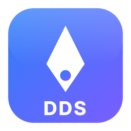
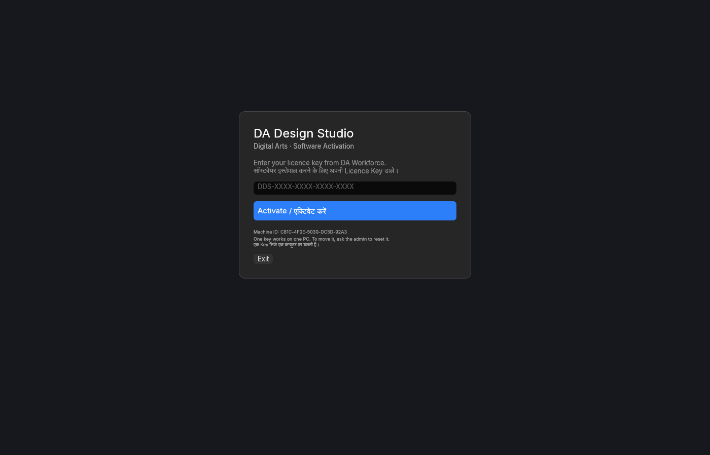
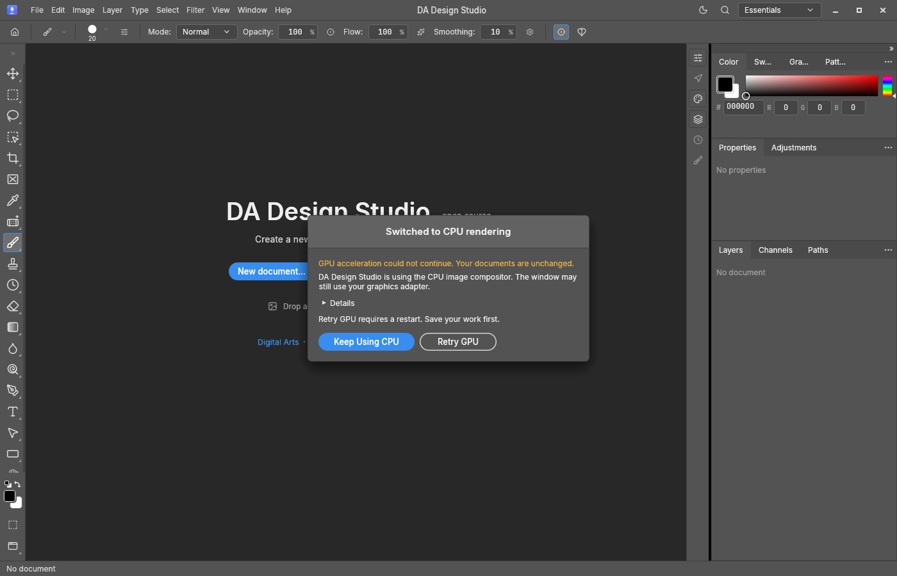
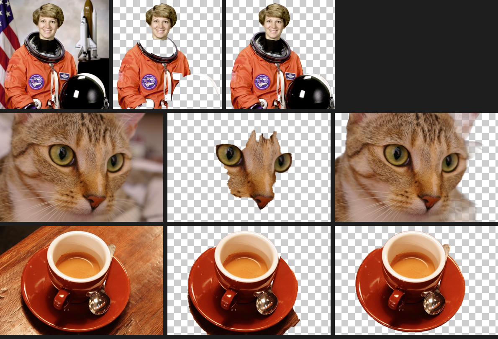
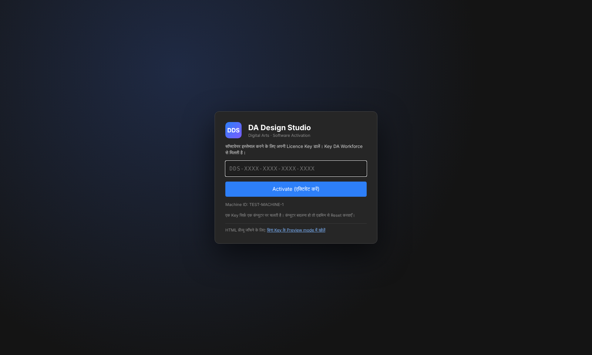
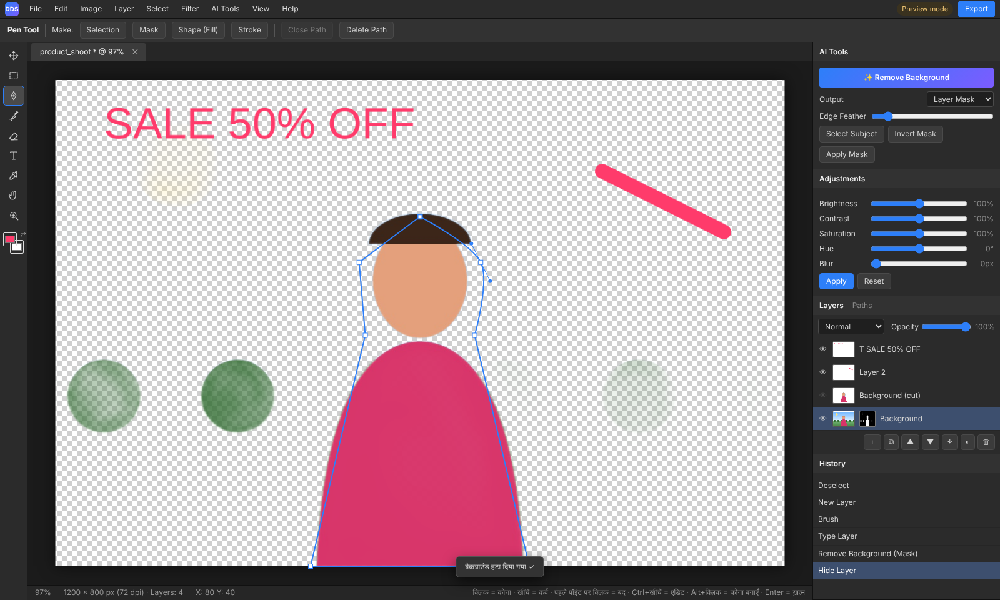
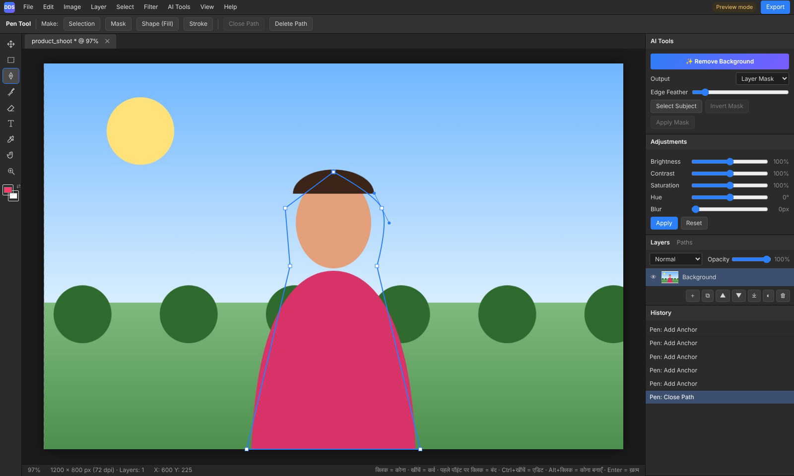
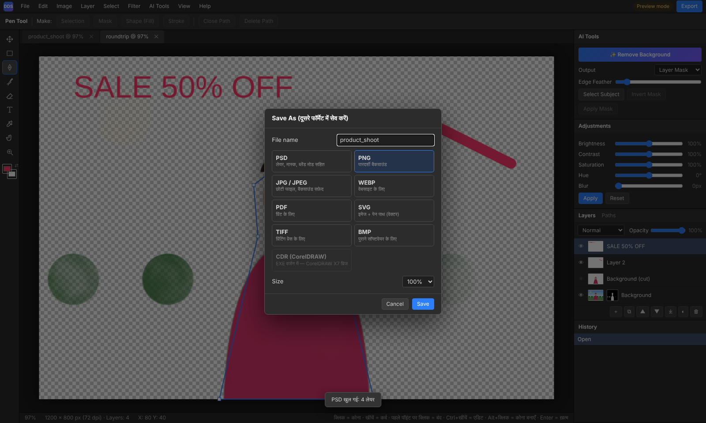

# DA Design Studio

Digital Arts का Windows इमेज एडिटर: PSD फाइल खोलना और सेव करना, Pen Tool, लेयर और मास्क, ऑफलाइन AI से बैकग्राउंड हटाना, और कई फॉर्मेट में Save As। चलाने के लिए DA Workforce से मिली Licence Key (`DDS-XXXX-XXXX-XXXX-XXXX`) चाहिए।

Windows image editor by Digital Arts: open and save PSD files, Pen tool, layers and masks, offline AI background removal, and Save As in many formats. It needs a licence key from DA Workforce.

**स्थिति / Status:** टेस्ट बिल्ड (v1.1.0)। इंस्टॉलर अभी यहाँ नहीं डाला गया है। CorelDRAW (.cdr) सपोर्ट अगले चरण में आएगा।
Test build (v1.1.0). The installer is not published here yet; CorelDRAW (.cdr) support comes next.

## स्क्रीनशॉट / Screenshots: Windows software

**एक्टिवेशन: पहली बार Licence Key डालें (DA Workforce से जुड़ा, एक Key एक कंप्यूटर)**

**एडिटर का शुरुआती पेज**

**AI Remove Background: बाएँ मूल फोटो, बीच में पुराना तरीका, दाएँ नया AI (ISNet, ऑफलाइन)**

## स्क्रीनशॉट / Screenshots: HTML preview app

ब्राउज़र में चलने वाला शुरुआती वर्जन, जिससे फीचर और डिज़ाइन तय किए गए।
The first browser version, used to settle the features and the design.

**एक्टिवेशन स्क्रीन**

**एडिटर: लेयर, मास्क, AI Tools और History**

**Pen Tool: कर्व वाला पाथ, जिसे Selection, Mask या Shape बनाया जा सकता है**

**Save As: PSD, PNG, JPG, WEBP, PDF, SVG, TIFF, BMP (CDR अगले चरण में)**

---

DA Design Studio is built on [PhotoCraft](https://github.com/storytold/photocraft) (MIT OR Apache-2.0). The AI background model is ISNet (Apache-2.0).
