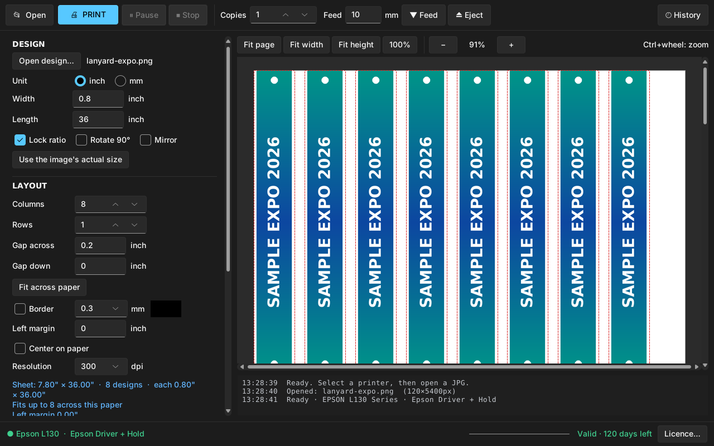
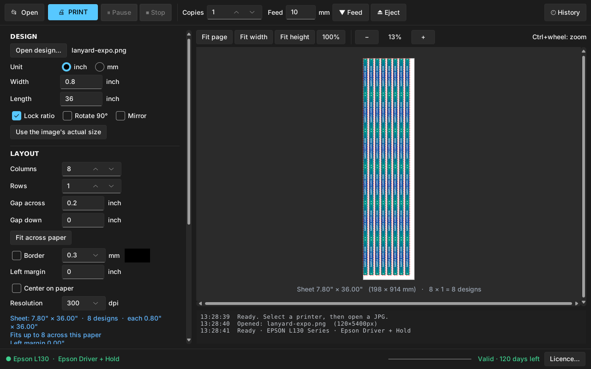
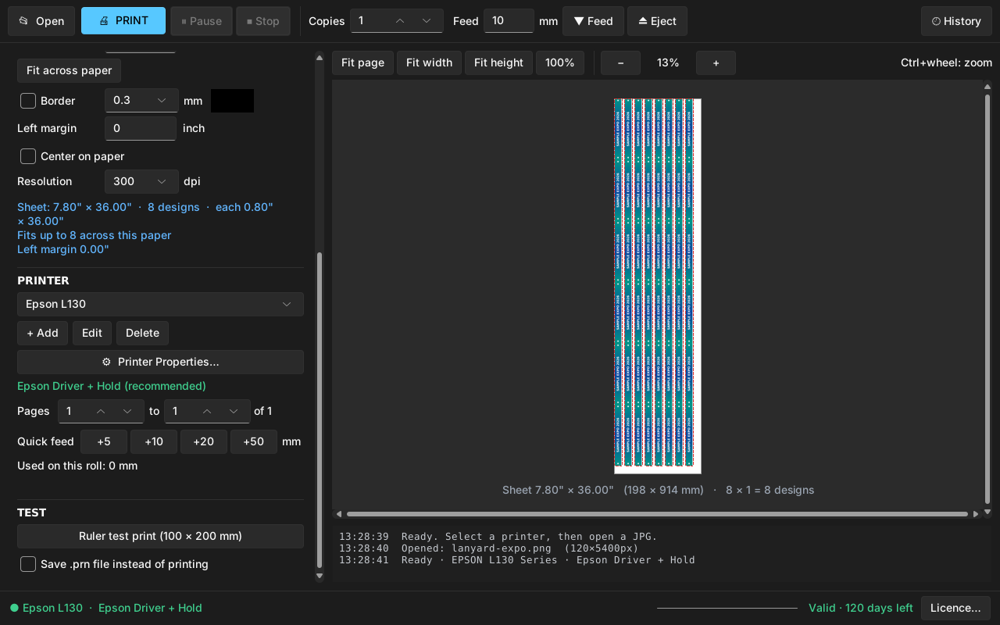
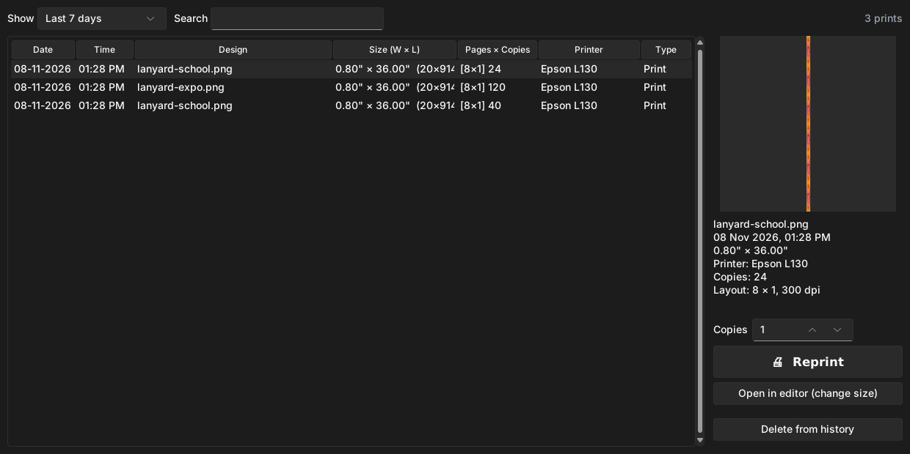

# Lanyard Roll Print v1.1.2

लंबे डिज़ाइन (जैसे 0.8" × 36" लैनयार्ड या 8.5" × 40" बैनर) को Epson L130 और दूसरे इंकजेट प्रिंटर पर रोल/लंबे पेपर पर प्रिंट करने वाला Windows सॉफ्टवेयर। पेपर प्रिंटर में पकड़ा रहता है, तय दूरी तक आगे खिसकता है और अगला प्रिंट वहीं से शुरू होता है।

Windows software for printing long designs on Epson L130 and other inkjet printers. It holds the paper in the printer between prints, feeds it by a set distance and ejects only when you ask.

## ⬇️ डाउनलोड / Download

**[LanyardRollPrint-Setup-1.1.2.exe](https://github.com/datplindia/digital-toolbox-updates/raw/main/lanyard-roll-print/LanyardRollPrint-Setup-1.1.2.exe)**: Windows 10 / 11 (64-bit), लगभग 30 MB। इंस्टॉलर में Desktop और Start Menu शॉर्टकट का विकल्प है।

SHA-256: `9d43483e065341f977febffc879da081a82d129c7152e5155560a798dbfb9778`

चलाने के लिए एक्टिवेशन (लाइसेंस) की ज़रूरत होती है।

## स्क्रीनशॉट / Screenshots

**डिज़ाइन, लेआउट और प्रिंटर, सब एक ही पेज पर (Fit width)**

**पूरी शीट का प्रीव्यू (Fit page)**

**प्रिंटर सेटिंग्स, Quick feed और Test print**

**प्रिंट हिस्ट्री: तारीख के हिसाब से पुराने प्रिंट दोबारा निकालें**

## फ़ीचर / Features

- JPG, PNG और PDF डिज़ाइन; चौड़ाई/लंबाई inch या mm में, Rotate 90° और Mirror।
- **लेआउट:** कई कॉलम × रो, बीच का गैप, "Fit across paper", बॉर्डर (मोटाई और रंग), लेफ़्ट मार्जिन या पेपर के बीच में।
- **Epson Driver + Hold** मोड: हर प्रिंट के बाद पेपर बाहर नहीं निकलता। **Feed** और **Eject** बटन, Quick feed (+5 / +10 / +20 / +50 mm)।
- Copies, पेज रेंज (PDF), **Pause / Stop**।
- **Printer Properties** सीधे ऐप से; एक से ज़्यादा प्रिंटर प्रोफ़ाइल।
- Resolution विकल्प, प्रीव्यू ज़ूम (Fit page / Fit width / Fit height / 100%, Ctrl + व्हील)।
- **History:** तारीख के हिसाब से पुराने प्रिंट देखें और दोबारा प्रिंट करें।
- Ruler test print, जिससे फ़ीड की दूरी जाँच सकें।

## अपने बिज़नेस के लिए सॉफ्टवेयर चाहिए? / Need software for your business?

🌐 [www.datpl.com](https://www.datpl.com) · 📞 / WhatsApp: [+91 99332 11177](https://wa.me/919933211177)

---

© 2026 Digital Arts · Port Blair, Andaman & Nicobar Islands
